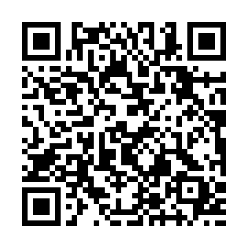
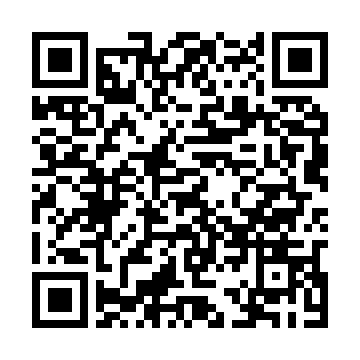

# Delta3DS

A GameMaker runner for the Nintendo 3DS, aimed at running **your own copy of DELTARUNE** on Old and New 3DS consoles.

Delta3DS is not a port and contains no game files. It works like ScummVM. The 3DS app reads the `data.win` from the copy of the game you bought, interprets its compiled GameMaker bytecode, and bridges every GameMaker function the game calls to the 3DS hardware (citro2d graphics, ndsp audio, buttons, SD card saves).

> **Status: early foundation, not playable yet.** The interpreter, `data.win` reader, room/event runtime, about 600 built-in functions and the texture converter are written and tested on the desktop against synthetic test games. Nobody has run it on a 3DS or with a real `data.win` yet. Expect the first runs to hit unimplemented functions and format differences. [docs/STATUS.md](docs/STATUS.md) lists what is done and what is missing.

## What you need

- A 3DS with custom firmware and the Homebrew Launcher.
- A dump of the DSP firmware (`sdmc:/3ds/dspfirm.cdc`, made with the *DSP1* homebrew). Without it there is no sound.
- DELTARUNE for **Windows**, bought by you. Only the PC files work, because the runner needs a `data.win` with bytecode.
- A PC with Python 3.8+ and the packages in `tools/requirements.txt` (`pip install pillow numpy`).

## Install with FBI (QR code)

On your 3DS, open **FBI → Remote Install → Scan QR Code** and point the camera at the code for your console:

| New 3DS / New 3DS XL / New 2DS XL | Old 3DS / 3DS XL / 2DS |
|:---:|:---:|
|  |  |
| [Delta3DS.cia](https://github.com/lucs-max/Delta3Ds/releases/download/nightly/Delta3DS.cia) | [Delta3DS-old.cia](https://github.com/lucs-max/Delta3Ds/releases/download/nightly/Delta3DS-old.cia) |

FBI downloads and installs the newest build. Every push rebuilds the CIAs and replaces the files on the [`nightly` release](https://github.com/lucs-max/Delta3Ds/releases/tag/nightly), but the links stay the same, so these QR codes always install the latest version. Scan again to update. The two builds have different title IDs, so both can be installed at once.

**From your own PC instead:** put the `.cia` files in a folder and run

```bash
python3 tools/serve_qr.py path/to/folder
```

This shares the folder on your local network and shows a QR code for each CIA in the terminal (it also saves them as PNGs). Scan one with FBI. The PC and the 3DS must be on the same Wi-Fi.

To make a QR code for any other `.cia` link:

```bash
python3 tools/make_qr.py https://example.com/file.cia qr.png
```

The QR tools need `pip install qrcode pillow`.

## Which build to use

| File | Console | Differences |
|---|---|---|
| `Delta3DS.cia` / `Delta3DS.3dsx` | New 3DS, New 3DS XL, New 2DS XL | 804 MHz CPU + L2 cache, full-colour (RGBA8) textures, 40 MB texture cache, audio decoding on core 2 |
| `Delta3DS-old.cia` / `Delta3DS-old.3dsx` | Old 3DS, 3DS XL, 2DS | 16-bit (RGBA4) textures to halve memory, 14 MB texture cache, audio decoding on core 1 |

The New 3DS build warns you if it starts on an Old 3DS. The Old 3DS build also runs on a New 3DS, just more slowly.

## Setup

1. **Convert the textures on your PC.** Point the converter at the game's install folder (the folder with `data.win`, or with the chapter folders):

   ```bash
   python3 tools/d3ds_convert.py "C:/Program Files (x86)/Steam/steamapps/common/DELTARUNE" --out D3DS_SD
   ```

   This copies the game files the 3DS needs (`data.win`, music, audio groups, language files) into `D3DS_SD/`. It also writes a `d3ds/` folder of 3DS textures next to every `data.win` it finds. The converter repacks every sprite into 1024×1024 atlases in the 3DS GPU's tiled format.

2. **Copy to the SD card:** put the contents of `D3DS_SD/` in `sdmc:/3ds/Delta3DS/`, so you have for example `sdmc:/3ds/Delta3DS/data.win` and `sdmc:/3ds/Delta3DS/chapter1_windows/data.win`.

3. **Install the app.** The easiest way is to scan a QR code with FBI (see [Install with FBI](#install-with-fbi-qr-code)). This installs Delta3DS as a CIA, so it gets its own icon on the HOME Menu. Alternatively, put `Delta3DS.3dsx` (New 3DS) or `Delta3DS-old.3dsx` (Old 3DS) in `sdmc:/3ds/` and use the Homebrew Launcher.

4. Start it from the HOME Menu (or the Homebrew Launcher) and pick a folder on the bottom screen. When a game calls `game_change()` (the chapter select does this), the runner starts the chapter's `data.win` by itself.

Saves go to `sdmc:/3ds/Delta3DS/saves/`. The log goes to `sdmc:/3ds/Delta3DS/delta3ds.log` and also shows on the bottom screen. Please attach it when you report a problem.

## Controls

| 3DS | Game key |
|---|---|
| D-pad / Circle Pad | Arrow keys |
| A | Z / Enter (confirm) |
| B | X / Shift (cancel, hold to run) |
| X | C / Ctrl (menu) |
| Y | Shift (run) |
| START | C (menu) |
| SELECT | Escape |
| START + SELECT (hold 1 s) | Quit to the game list |

## Screen

GameMaker games usually render at 640×480. The top screen shows that window at exactly half size (320×240, centred). DELTARUNE draws its pixel art at 2× scale, so this is pixel-perfect. The bottom screen shows status and log messages.

## Building

The 3DS builds need [devkitPro](https://devkitpro.org/wiki/Getting_Started) with devkitARM, libctru, citro2d/citro3d and the tremor port library:

```bash
dkp-pacman -S 3ds-dev 3ds-libvorbisidec 3ds-libogg
```

```bash
make            # both builds
```

```bash
make new        # Delta3DS.3dsx
```

```bash
make old        # Delta3DS-old.3dsx
```

```bash
make cia        # Delta3DS.cia + Delta3DS-old.cia (also needs makerom and bannertool in PATH)
```

The interpreter also builds on a normal PC, where it runs headless for testing:

```bash
make test       # builds build_host/delta3ds_host and runs tests/run_tests.sh
```

```bash
build_host/delta3ds_host path/to/data.win 300
```

The second command runs 300 frames of a game and logs every function the game calls that isn't implemented yet. That is the fastest way to find out what a real game still needs. Set `D3_TRACE_DRAW=1` to print every draw call.

On every push, GitHub Actions builds both versions as `.3dsx` and `.cia`, makes the QR codes, and publishes everything on the `nightly` release (see `.github/workflows/build.yml`).

## How it works

```
data.win ──► datawin.c ──► vm.c (bytecode interpreter) ──► builtins*.c (GameMaker API)
   (your copy)    reader        runtime.c (instances, rooms, events)       │
                                                                          ▼
                      tools/d3ds_convert.py ──► d3ds/atlas_*.bin ──► platform_3ds.c
                      (textures, run on PC)                         citro2d · ndsp · hid · SD
```

- `src/core/datawin.c` loads `data.win` from the start up to the texture/audio chunks (those are read on demand) and patches the variable and function reference chains in the bytecode.
- `src/core/vm.c` is a stack interpreter for GameMaker bytecode 15–17 (GameMaker Studio 2.3 to GameMaker 2024). It covers `with` blocks, structs, methods, arrays with copy-on-write, statics and the 2.3 array opcodes.
- `src/core/runtime.c` handles the instance list, the event order (begin step, alarms, keyboard, step, motion, collisions, end step, animation, draw passes), rooms, persistent objects and views.
- `src/core/builtins*.c` implements the GameMaker function library: math, strings (UTF-8), arrays, structs, instances, collisions, layers, cameras, drawing and text, audio, `ds_*`, JSON, INI and text files.
- `src/platform/platform.h` is the bridge interface. `platform_3ds.c` implements it for the 3DS, and `src/host/platform_host.c` implements it for desktop tests.

## Legal

Delta3DS contains no code, graphics, sound or text from DELTARUNE or any other game, and must never be distributed with game files. You need your own legally obtained copy. DELTARUNE is © Toby Fox. This project is not affiliated with or endorsed by Toby Fox, 8-4 or YoYo Games.

The runner's source code is under the MIT license (see `LICENSE`).
